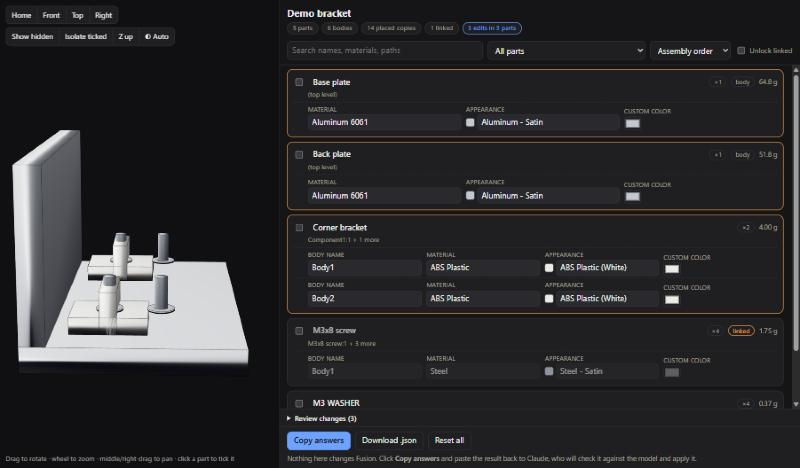

# Fusion Parts Editor

A [Claude](https://claude.ai) skill for cleaning up the parts of a Fusion 360 assembly. It exports the assembly you have open, gives you a visual scratchpad where you rename parts and change materials, appearances and colors in bulk, then takes your answers and writes the changes back to the open Fusion design.



*The scratchpad, on the made-up demo assembly in `examples/`. Edited fields turn amber, and screws that live in another Fusion document are locked.*

## What it does

- **Exports** every part of the open assembly (names, bodies, materials, appearances, colors, masses, 3D shapes, how many copies are placed) without changing anything in Fusion.
- **Builds one HTML page** with a rotatable 3D view and an editable parts table. Rename components and bodies, pick materials and appearances from your Fusion libraries, choose custom colors, and edit many parts at once (set a material, find and replace in names, add a prefix or suffix). Search, filter ("Default names", "Linked", "Changed") and sort.
- **Applies your answers.** You click *Copy answers*, paste them into the chat, and Claude checks them against the live model (a dry run), applies them, then exports again to confirm the result. It never saves the document.

- **Optional: shapes from the STEP file.** By default the 3D view uses Fusion's own mesh of each body. With the STEP option, the design is exported as a STEP file and the shapes come from its exact surfaces (read with OpenCascade), matched back to Fusion's parts by center of mass and volume. Edits are not affected: they are written back by part path.

The page is the same every time; only the data from your model changes, so every scratchpad looks and works the same.

## How it works

```
Fusion (open assembly)
   │  fusion_export.py  (read-only, run through the Fusion MCP connector)
   ▼
assembly.json + meshes.json
   │  build_editor.mjs  (Node)
   ▼
parts-editor.html  ──  you edit in your browser  ──►  "Copy answers" (JSON)
                                                          │  paste into the chat
                                                          ▼
Fusion (open assembly)  ◄──  fusion_apply.py: dry run, then apply  ◄──  Claude
   │
   └─ export again and compare, so the result is verified
```

## Requirements

- **Claude** with skills: the Claude desktop app (Code tab) or Claude Code.
- **Autodesk Fusion** (Fusion 360) running, with a Fusion MCP connection that lets Claude run scripts in Fusion (the connector that provides `fusion_mcp_execute` and `fusion_mcp_read`).
- **Node.js 18 or newer** for the page builder.
- Only for the STEP option: run `npm install` once in `fusion-parts-editor/scripts` (it installs the `occt-import-js` package, about 8 MB).
- A normal web browser (Chrome or Edge) to open the page. The page loads three.js from the jsDelivr CDN, so it needs an internet connection.

## Install

A skill is a folder that Claude looks for in your skills directory.

**Option 1: copy the folder.** Copy `fusion-parts-editor/` into your user skills folder:

- macOS / Linux: `~/.claude/skills/fusion-parts-editor`
- Windows: `%USERPROFILE%\.claude\skills\fusion-parts-editor`

**Option 2: use the install script** (does the same copy, replacing an older version):

```bash
node tools/install.mjs
```

Start a new Claude session afterward so the skill is picked up.

## Use

Open an assembly in Fusion and tell Claude something like:

- "Use the parts editor on this assembly."
- "Make me a scratchpad to rename the parts and fix the materials."
- "Clean up the Body1 / Component3 names in my Fusion design."

Claude exports the model, tells you where the page is, and waits. Edit in the page, click **Copy answers**, and paste the result back. Claude then shows what will change (and anything it will skip, and why), applies it, and re-exports to check.

## Try it without Fusion

A small made-up assembly is included so you can see the page without Fusion:

```bash
node tools/make-sample.mjs
node fusion-parts-editor/scripts/build_editor.mjs examples/sample-export examples/sample-export/parts-editor.html
```

Then open `examples/sample-export/parts-editor.html` in a browser. (A pre-built copy is already in that folder.) You can edit and copy answers there, but applying them needs Fusion.

## Safety

- The export is read-only. Applying always starts with a dry run that changes nothing and lists each edit as `OK`, `ALREADY`, `BLOCKED`, `CONFLICT`, `MISSING` or `FAILED`.
- **The document is never saved.** Changes live in the open design; Ctrl+Z or closing without saving discards them.
- **Linked parts are locked.** Parts that live in another Fusion document accept edits in Fusion's API without any warning, which would silently change the other file. The page locks them and the apply script blocks them unless you explicitly agree.
- **Conflicts are detected.** If a material or appearance changed in Fusion after the export, that field is skipped and reported.
- Parts are identified by their occurrence path, not by IDs. Fusion's `entityToken` and `Component.id` are not unique in real assemblies (copies and linked documents share them), and trusting them would send edits to the wrong part.

## Limitations

- The skill has been tested on one real 61-part assembly (export and page) and on a throwaway document (dry run, apply, re-export). It has not been through formal skill evaluations, and it has not been tried on very large assemblies (thousands of parts) or other Fusion versions.
- The STEP option has been tried on one real assembly (44 solids matched to their Fusion bodies, largest gap 0.043 mm). Parts hidden in Fusion are not in the STEP file, so they have no shape in that mode, and `npm test` does not cover it.
- Hidden parts are exported and can be shown faintly, but a part hidden in Fusion may still count toward Fusion's own mass readout.
- Only names, materials, appearances and colors are written back. Other properties are out of scope.
- Fusion's files do not say which axis is up, so the page has a **Z up / Y up** switch.
- The page is typically a few hundred KB to a megabyte. The Claude desktop preview pane may not open pages over about 600 KB, so open the file in Chrome or Edge.

## Repository layout

| Path | What it is |
|---|---|
| `fusion-parts-editor/` | The skill itself. This is the folder to install. |
| `fusion-parts-editor/SKILL.md` | What Claude follows: the workflow, the safety rules, the Fusion gotchas. |
| `fusion-parts-editor/scripts/` | `fusion_export.py` and `fusion_apply.py` (run inside Fusion), `build_editor.mjs` (builds the page), `step_geometry.mjs` and `package.json` (the optional STEP shapes). |
| `fusion-parts-editor/assets/` | `parts-editor.template.html`, the page. |
| `fusion-parts-editor/references/` | The answers format, and notes on Fusion API behavior found while building this. |
| `examples/sample-export/` | A made-up assembly in export format, plus a built page. |
| `tools/` | `install.mjs`, `make-sample.mjs`, `smoke-test.mjs`. |
| `NOTES.md` | History, decisions, what is tested, ideas for next. |

## Development

```bash
npm test
```

runs a smoke test: it builds the page from the sample export and checks the output. The two Fusion scripts run inside Fusion's own Python, so they can only be checked against a real Fusion session.

## Legal

Autodesk and Fusion are trademarks of Autodesk, Inc. This project is not affiliated with or endorsed by Autodesk or Anthropic.

License: not chosen yet. Add a `LICENSE` file before publishing.
